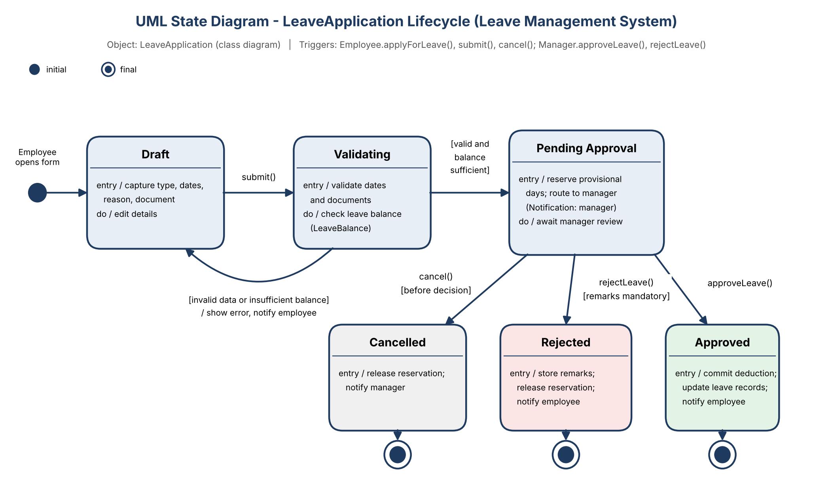

# Leave Management System (LMS)
### *An Automated Web-Based Solution for Employee Leave Management*


---

## 📌 Table of Contents
- [Project Overview](#-project-overview)
- [Project Team Members](#-project-team-members)
- [Problem Background & Statement](#-problem-background--statement)
- [Key Impacts & Benefits](#-key-impacts--benefits)
- [Core Features](#-core-features)
- [System Architecture & Design Diagrams](#-system-architecture--design-diagrams)
  - [1. System Architecture](#1-system-architecture-diagram)
  - [2. Use Case Model](#2-use-case-diagram)
  - [3. Workflow & Activity Diagram](#3-activity--workflow-diagram)
  - [4. Domain Class Diagram](#4-class-diagram--data-model)
  - [5. UML State Diagram (LeaveApplication Lifecycle)](#5-state-machine-diagram-leaveapplication-lifecycle)
- [Modularization & Software Design Analysis](#-modularization--software-design-analysis)
  - [Module Identification & Decomposition (M1–M8)](#module-identification--decomposition-m1m8)
  - [Design Strategy: Top-Down Decomposition](#design-strategy-top-down-decomposition)
  - [Design Approach: Object-Oriented Modeling](#design-approach-object-oriented-modeling)
  - [Coupling Analysis & Architectural Decoupling](#coupling-analysis--architectural-decoupling)
  - [Cohesion Analysis](#cohesion-analysis)
  - [Module Interaction & Sequence Dynamics](#module-interaction--sequence-dynamics)
  - [Design Quality Evaluation](#design-quality-evaluation)
- [Detailed Module Flowcharts & Algorithms](#-detailed-module-flowcharts--algorithms)
  - [Algorithmic Pseudocode Specifications](#algorithmic-pseudocode-specifications)
- [System Requirements Specification](#-system-requirements-specification)
  - [Functional Requirements](#functional-requirements)
  - [Non-Functional Requirements](#non-functional-requirements)
- [Project Scope](#-project-scope)
- [Technology Feasibility & Stack](#-technology-feasibility--stack)
- [Associated Modules: Attendance Management System](#-associated-modules-attendance-management-system-ams)
- [Expected Outcomes](#-expected-outcomes)
- [Repository Directory Structure](#-repository-directory-structure)
- [Documentation References](#-documentation-references)

---

## 👥 Project Team Members

This project is conceived, designed, developed, and documented as part of the **B.Tech Major Project** in **Computer Science Engineering** by:

| S. No. | Name | Roll Number | Project Role | Primary Responsibilities |
| :---: | :--- | :---: | :--- | :--- |
| **1** | **Varun Kushwah** | `2400290120275` | **Team Lead / Backend Development** | Architecture design, REST API development, business logic, workflow engine, and system integration |
| **2** | **Vaibhav Gupta** | `2400290120270` | **Frontend Development** | Responsive UI/UX implementation, client-side routing, employee/manager dashboards, calendar integration |
| **3** | **Tanya Bhadana** | `2400290120251` | **Database Design & Testing** | Relational schema design, normalization, data integrity, test suite design, and QA verification |
| **4** | **Sudiksha Chauhan** | `2400290120260` | **Documentation & UI/UX Design** | SRS/IEEE documentation, elicitation, wireframes, user journeys, and technical writing |

---

## 📖 Project Overview

Leave management is a fundamental administrative process within organizations, academic institutions, and corporate enterprises. The **Leave Management System (LMS)** is a modern, web-based platform engineered to eliminate paper-bound bureaucracy by digitizing and automating the complete employee leave application, approval, and record-keeping lifecycle.

By replacing disparate spreadsheets, physical forms, and manual approvals with a single, role-based, real-time portal, the system ensures data accuracy, accelerates request processing, provides transparent leave balances, and facilitates informed workforce planning.

---

## ❗ Problem Background & Statement

### Background
In traditional workplace settings, leave applications are submitted through handwritten paper forms or emailed ad-hoc spreadsheets. Supervisors must physically sign or manually approve requests, after which human resources (HR) staff manually reconcile and deduct days in separate logs.

### The Inefficiencies
- **Administrative Friction:** HR departments spend excessive time manually tallying days, accruals, and carry-forwards.
- **Lost & Misplaced Records:** Paper slips and email threads get misplaced, leading to auditing gaps.
- **Approval Bottlenecks:** Requests remain stalled when managers or approvers are travelling or out of office.
- **Absence of Visibility:** Employees have no real-time insight into available leave balances or processing status.
- **Resource Conflicts:** Lack of a unified team calendar causes multiple key personnel to take leave simultaneously without prior scheduling coordination.

### Problem Statement
> *"There is a critical need for a centralized, digital Leave Management System that allows employees to apply for leave online, enables managers or administrators to review and approve/reject requests efficiently, and automatically maintains accurate, real-time records of leave balances and leave history — thereby eliminating delays, human error, and lack of transparency associated with manual processing."*

---

## 🌟 Key Impacts & Benefits

```
   Manual Friction                Automated Digital LMS
┌──────────────────────┐         ┌─────────────────────────┐
│ Paper-based forms    │  ───►   │ 1-Click Online Request  │
│ Delayed sign-offs    │  ───►   │ Instant Notifications   │
│ Balance disputes     │  ───►   │ Automated Calculations  │
│ Misplaced records    │  ───►   │ Centralized SQL Database│
│ Scheduling blindness │  ───►   │ Unified Team Calendar   │
└──────────────────────┘         └─────────────────────────┘
```

- **Accelerated Turnaround:** Approval turnaround times decrease from days to minutes via automated routing.
- **100% Record Accuracy:** Direct database calculations prevent miscalculations and disputes.
- **Employee Self-Service:** Immediate self-check of remaining leave balances, accruals, and historical applications.
- **Managerial Decision Support:** Real-time visibility into team members' planned leaves prevents project delays.
- **Auditable & Compliant:** Centralized records facilitate compliance checks and HR management reports.

---

## ⚙️ Core Features

- **Role-Based Access Control (RBAC):** Tailored permissions and user interfaces for **Employees**, **Managers / Approvers**, and **Administrators / HR**.
- **Leave Application Engine:** Multi-category leave requests (Casual, Sick, Earned/Privilege, Maternity/Paternity) with date picking and mandatory supporting document attachments (e.g., medical certificates).
- **Automated Workflow & Routing:** Real-time routing of leave requests directly to the designated department manager.
- **Provisional Balance Reservation:** Temporary balance holding during pending states to prevent double-booking or overdrawing.
- **Interactive Team Calendar:** Visual representation of approved leaves to prevent department under-staffing.
- **Email & In-App Notifications:** Real-time dispatch of alerts for submission, manager review, approval, and rejection.
- **HR Administration Suite:** Management of annual holiday calendars, leave policy parameters (accrual rates, carry-forward limits), and analytical report exports.

---

## 📐 System Architecture & Design Diagrams

The design and engineering of the system are governed by standard software engineering models, illustrated in the architectural diagrams below:

---

### 1. System Architecture Diagram
The application follows a **3-Tier Layered Architecture** ensuring modularity, scalability, and security between the presentation, business logic, and persistence tiers.


#### Architectural Layers:
1. **Presentation Layer:**
   - Responsive web portals built with React.js and styled using Tailwind CSS, customized for Employees, Managers, and HR/Administrators accessible via desktop and mobile browsers.
2. **Application Layer (Backend / REST API):**
   - **API Gateway & Routing Controller:** Entry point validating routes, CORS, and request forwarding.
   - **Authentication & Authorization Service:** Manages user sessions, password hashing (bcrypt), and role verification (RBAC + JWT).
   - **Leave Workflow Engine:** Core orchestrator processing status transitions, approvals, and balance adjustments.
   - **Policy & Configuration Manager:** Enforces department rules, accrual rates, and annual limits.
   - **Reporting & Analytics Engine:** Generates department summaries and organizational leave analytics.
   - **Notification Service:** Communicates asynchronously with external SMTP servers.
3. **External Integrations:**
   - **Email SMTP Server:** Dispatches instant transactional email updates to employees and approvers via Spring Boot Mail / Nodemailer.
4. **Data Layer:**
   - **Relational Database (PostgreSQL / MySQL):** Maintains referential integrity for identity, application logs, policies, balances, and audit trails.
5. **Deployment Infrastructure:**
   - Cloud-native containerized deployment model using Docker, suitable for hosting on platforms such as AWS (EC2/RDS), Microsoft Azure, or Heroku.

---

### 2. Use Case Diagram
The Use Case diagram specifies the interactions between external actors and system boundaries, differentiating user-facing actions, automated background services, and exception branches.


#### Actors & Functional Allocations:
- **Employee:**
  - *Apply for Leave:* Includes automated validations (`Validate Request`), live balance calculation (`Calculate Leave Balance`), and dispatch (`Route Request to Manager`).
  - *Exception Handling:* Extends `Insufficient Balance Error` if requested days exceed entitlement.
  - *View Leave Status:* Checks remaining balance by type and past historical submissions.
- **Manager / Approver:**
  - *Review Leave Requests (Approve / Reject):* Includes automatic triggers to `Send Notifications` and `Update Leave Records`.
  - *Exception Handling:* Extends `Request Rejected` with compulsory feedback/remarks.
  - *View Team Calendar:* Assesses workforce density before approving or rejecting.
- **Administrator / HR:**
  - *Manage Users:* Provisions accounts, assigns roles, and updates employee departments.
  - *Manage Policies & Holidays:* Defines leave types, accrual caps, carry-over rules, and official holidays.
  - *Generate Reports:* Extracts organizational and department-level leave trend analytics.
- **HR / Payroll System:**
  - Downstream integration actor reflecting finalized leave deductions for records and payroll compliance.

---

### 3. Activity & Workflow Diagram
The Activity Swimlane diagram delineates the end-to-end execution flow between the **Employee**, the **System Core**, and the **Manager**.


#### Step-by-Step Lifecycle:
1. **Initiation (Employee):** Employee logs in, navigates to "Apply for Leave", selects leave type, date range, specifies reason, and uploads supporting documents (if required).
2. **Validation & Balance Check (System):** System validates the date validity and inspects the employee's available balance:
   - *If Balance Insufficient:* Displays error prompt, terminates request, and dispatches notification.
   - *If Balance Sufficient:* Deducts provisional balance and forwards request to the manager's pending queue.
3. **Managerial Evaluation (Manager):** Manager reviews details and verifies the team work calendar:
   - *Case Rejection:* Manager enters reason for denial $\rightarrow$ System rolls back and reverses the provisional balance $\rightarrow$ Sends rejection notification.
   - *Case Approval:* Manager confirms approval $\rightarrow$ System commits the deduction to the final balance $\rightarrow$ Updates leave records $\rightarrow$ Sends approval notification.
4. **Completion (Employee):** Employee receives the notification and views their refreshed leave history and balance ledger.

---

### 4. Class Diagram & Data Model
The Class Diagram outlines the Object-Oriented design and data schema, highlighting identity boundaries, workflow state machines, and administrative entities.


#### Entity Class Breakdown:
- **Identity & User Roles (`«Identity»`):**
  - `User`: Base abstraction encapsulating `id`, `name`, `email`, `passwordHash`, `role`, `login()`, and `logout()`.
  - `Employee`: Inherits `User`. Adds `employeeId`, `department`, `joiningDate`, `applyForLeave()`, and `viewBalance()`.
  - `Manager`: Inherits `User`. Adds `managerId`, `reviewLeave()`, `approveLeave()`, and `rejectLeave()`.
  - `Administrator`: Inherits `User`. Adds `adminId`, `manageUsers()`, `configurePolicies()`, and `generateReport()`.
- **Workflow & Automation (`«Workflow»`):**
  - `LeaveApplication`: Contains `applicationId`, `startDate`, `endDate`, `reason`, `status`, `appliedDate`, `supportingDocument`, and methods `submit()` / `cancel()`.
  - `LeaveBalance`: Tracks `balanceId`, `availableDays`, and `usedDays`, with operations `deductDays()` and `addDays()`.
  - `LeaveType`: Defines category attributes (`typeId`, `typeName`, `maxDaysAllowed`).
  - `Notification`: Manages alerts (`notificationId`, `message`, `timestamp`, `isRead`, `send()`).
- **Administrative & Reporting (`«Admin»`):**
  - `LeavePolicy`: Governs `policyId`, `accrualRate`, and `carryForwardLimit`.
  - `Holiday`: Records `holidayId`, `holidayName`, `date`, and `department`.
  - `Report`: Coordinates `reportId`, `reportType`, `generatedDate`, and `generate()`.

---

### 5. State Machine Diagram (LeaveApplication Lifecycle)
The UML State Machine Diagram specifies the complete lifecycle states, state transitions, triggers, and guard conditions for a `LeaveApplication` entity.



#### Lifecycle States & State Transition Matrix:
| State | Entry Action | Trigger / Event | Guard Condition | Target State | Exit / Transition Action |
| :--- | :--- | :--- | :--- | :--- | :--- |
| **Initial** | Employee opens application form | Open form | Session valid | **Draft** | Initialize request form |
| **Draft** | Capture leave type, date range, reason, supporting document | `submit()` | All required fields present | **Validating** | Execute client & server validations |
| **Validating** | Validate date integrity and check active employee status | `checkBalance()` | `[valid and balance sufficient]` | **Pending Approval** | Reserve provisional days, route to manager queue, dispatch alert |
| **Validating** | Evaluate balance availability against entitlement | Evaluation failure | `[invalid data or insufficient balance]` | **Draft** | Display validation error, notify employee |
| **Pending Approval** | Hold provisional balance; await manager review | `approveLeave()` | Manager authorized | **Approved** *(Final)* | Commit deduction to balance, update leave ledger, notify employee |
| **Pending Approval** | Await manager review | `rejectLeave()` | Mandatory remarks provided | **Rejected** *(Final)* | Record rejection reason, release provisional reservation, notify employee |
| **Pending Approval** | Await review | `cancel()` | `[before decision & start date]` | **Cancelled** *(Final)* | Release provisional balance reservation, notify manager |

---

## 🧩 Modularization & Software Design Analysis

Derived from the formal **Software Design Analysis Report** ([PDF](Software_Design_Analysis_Report_Leave_Management_System.pdf)), the system is architected around principles of high cohesion, loose coupling, and clear separation of concerns.

### Module Identification & Decomposition (M1–M8)

The system is decomposed into **8 major functional modules** in the Application Layer:

| ID | Module Name | Primary Responsibility | Inputs / Outputs | Dependencies |
| :---: | :--- | :--- | :--- | :--- |
| **M1** | **User, Authentication & Access** | User registration/login, bcrypt password hashing, RBAC enforcement (Employee, Manager, Admin), account lockout management. | Credentials / user data $\rightarrow$ JWT session token, user ID, role. | Shared Database (User records) |
| **M2** | **Leave Application** | Request formulation, date validation, working-day calculation (excluding holidays/weekends), document upload. | Type, dates, reason, document $\rightarrow$ Validated application object. | M1 (Identity), M4 (Balance check), M5 (Leave types) |
| **M3** | **Approval Workflow** | Queue routing to assigned managers, decision recording (`APPROVE`/`REJECT`), mandatory feedback capture. | Application ID, decision, remarks $\rightarrow$ Updated lifecycle status. | M1 (Role auth), M2, M4, M6 (Alerts) |
| **M4** | **Leave Balance & History** | Provisional day reservation, atomic deduction commit on approval, rollback on rejection/cancellation, accrual calculations. | Employee ID, leave type, days $\rightarrow$ Balance status, ledger history. | M5 (Policy rules), Relational Database |
| **M5** | **Policy & Holiday Configuration** | Administrative setup of leave categories, yearly quotas, carry-forward caps, department holiday calendars. | Policy parameters, holiday dates $\rightarrow$ Persisted system configuration. | M1 (Admin role auth), Database |
| **M6** | **Notification** | Composing and dispatching transactional emails (via SMTP) and in-app notifications upon key lifecycle events. | Event trigger, recipient ID, message template $\rightarrow$ Delivery status. | External SMTP Server / Gateway |
| **M7** | **Team Calendar** | Aggregating and visualizing approved leaves and public holidays per team/department for staffing visibility. | Department ID, month/year $\rightarrow$ Team schedule entries. | M3 (Approved leaves), M5 (Holidays) |
| **M8** | **Reports & Analytics** | Aggregating departmental metrics, monthly leave trends, approval vs rejection rates, CSV/PDF report exports. | Time period, department $\rightarrow$ Aggregated analytics / export file. | M4 (History), M5 (Policies), Database |

```
                              ┌─────────────────────────────┐
                              │   LEAVE MANAGEMENT SYSTEM   │
                              └──────────────┬──────────────┘
         ┌──────────────┬─────────────┬──────┴──────┬─────────────┬──────────────┬──────────────┐
         ▼              ▼             ▼             ▼             ▼              ▼              ▼
   ┌───────────┐  ┌───────────┐ ┌───────────┐ ┌───────────┐ ┌───────────┐  ┌───────────┐  ┌───────────┐
   │    M1     │  │    M2     │ │    M3     │ │    M4     │ │    M5     │  │    M6     │  │    M7     │
   │  User &   │  │   Leave   │ │ Approval  │ │ Balance & │ │  Policy &  │  │  Notify   │  │   Team    │
   │   Auth    │  │Application│ │ Workflow  │ │  History  │ │ Holidays  │  │  Engine   │  │ Calendar  │
   └───────────┘  └───────────┘ └───────────┘ └───────────┘ └───────────┘  └───────────┘  └───────────┘
                                                                                         ┌───────────┐
                                                                                   M8 ──►│ Reports & │
                                                                                         │ Analytics │
                                                                                         └───────────┘
```

---

### Design Strategy: Top-Down Decomposition

The architectural design follows a formal **Top-Down Decomposition Strategy**:
1. **System Level:** The entire LMS is identified alongside its primary stakeholders (Employee, Manager, HR/Admin).
2. **Layer Level:** Partitioned into 3 tiers (Presentation, Application REST API, Persistence/Data Layer).
3. **Module Level:** The Application Layer is split into 8 focused functional responsibilities (M1 through M8).
4. **Subfunction Level:** Specific use case interactions within each module (e.g., `checkBalance()`, `reserveDays()`, `commitDeduction()`).
5. **Class / Data Level:** Concrete OOP classes, domain models, and relational database schemas.

---

### Design Approach: Object-Oriented Modeling

The domain model adheres to **Object-Oriented (OO)** design principles:
- **Abstraction & Real-World Mapping:** Real-world entities map directly to classes (`LeaveApplication`, `LeaveBalance`, `LeavePolicy`, `Employee`).
- **Inheritance Hierarchy:** Specialization from base `User` entity to `Employee`, `Manager`, and `Administrator`.
- **Encapsulation:** State mutations are protected behind explicit methods (e.g., `deductDays()`, `addDays()` in `LeaveBalance`; status modifications via `submit()`, `cancel()`, `approveLeave()`, `rejectLeave()`).
- **Data-Driven Maintainability:** New leave categories and policies are configured as data records (`LeaveType`, `LeavePolicy`) rather than requiring code refactoring.

---

### Coupling Analysis & Architectural Decoupling

The architecture targets **Low Coupling** to prevent cascading failures and ensure independent testability:

| Module Pair | Shared Data / Interaction | Coupling Type | Architectural Decoupling Strategy |
| :--- | :--- | :---: | :--- |
| **M1 (Auth) $\leftrightarrow$ M2 / M3 / M5** | User identity & role claims | **Data Coupling** *(Low)* | Handled via stateless JWT claims verified in a shared security filter; full user records are never passed. |
| **M2 (Application) $\rightarrow$ M4 (Balance)** | Employee ID, leave type, requested days | **Data Coupling** *(Low)* | Exposed via a narrow interface `checkBalance(empId, type, days)`; M2 never accesses balance tables directly. |
| **M2 (Application) $\rightarrow$ M3 (Workflow)** | Application ID for review queue routing | **Stamp $\rightarrow$ Data** *(Reduced)* | Pass only primitive `applicationId`; M3 loads required fields via its repository interface. |
| **M3 (Workflow) $\rightarrow$ M4 (Balance)** | Lifecycle decision outcome | **Control $\rightarrow$ Data** *(Reduced)* | Rather than passing a control flag, expose explicit semantic methods: `commitDeduction()` on approval and `releaseReservation()` on rejection. |
| **M3 (Workflow) $\rightarrow$ M6 (Notification)** | Workflow event, recipient, payload | **Data Coupling** *(Low)* | Event-driven dispatch: M3 publishes events; M6 handles email templates and SMTP transport. |
| **M7 / M8 $\rightarrow$ M3 / M4 / M5** | Historical logs, holiday dates | **Data Coupling** *(Low)* | Dedicated read-only projection queries returning only aggregated/summary data. |
| **React UI $\leftrightarrow$ Spring Boot API** | JSON REST DTO payloads | **Data Coupling** *(Low)* | Standard RESTful API contract over HTTPS, decoupled from server-side database implementations. |

---

### Cohesion Analysis

Every module exhibits **High Functional Cohesion**, ensuring each component addresses a single, well-defined purpose:
- **M1 (User & Auth):** Dedicated strictly to authentication, password hashing, and role verification (no business logic).
- **M2 (Leave Application):** Focuses solely on date parsing, working day calculation, and submission validation.
- **M3 (Approval Workflow):** Confined to workflow state orchestration and approval tracking.
- **M4 (Balance & History):** Manages atomic balance arithmetic, provisional holds, and transaction rollback/commit.
- **M5 (Policy & Holiday):** Centralized CRUD operations for enterprise leave rules and official holidays.
- **M6 (Notification):** Dedicated strictly to template composition and asynchronous dispatch.
- **M7 (Team Calendar):** Purely read-only scheduling queries for workforce visibility.
- **M8 (Reports & Analytics):** High functional/sequential cohesion for data extraction, aggregation, and export formatting.

---

### Module Interaction & Sequence Dynamics

The sequence of interactions for a standard leave request lifecycle illustrates how decoupled modules collaborate:

```
Employee        Web UI         M1 Auth       M2 Application    M4 Balance      M3 Workflow     M6 Notify     Manager
   │              │               │                │               │               │               │            │
   │──Apply Form─►│               │                │               │               │               │            │
   │              │──POST+Token──►│                │               │               │               │            │
   │              │               │──Verify Token─►│               │               │               │            │
   │              │               │   (Valid ID)   │──Validate────►│               │               │            │
   │              │               │                │──Chk Balance─►│               │               │            │
   │              │               │                │◄──Sufficient──│               │               │            │
   │              │               │                │──Reserve Days►│               │               │            │
   │              │               │                │──Submit App──────────────────►│               │            │
   │              │               │                │                               │──Send Alert──►│            │
   │              │               │                │                               │               │──Email────►│
   │              │               │                │                               │◄──APPROVE/REJ──────────────│
   │              │               │                │                               │──Commit/Roll─►│ (Balance)  │
   │              │               │                │                               │──Notify User─►│            │
   │◄──Status Upd──────────────────────────────────────────────────────────────────────────────────│            │
```

---

### Design Quality Evaluation

- **Maintainability:** Policies, holidays, and leave rules are persisted as data entities; changes require no code modifications.
- **Testability:** Decoupled interfaces enable isolated unit testing for balance calculations, accruals, and validation logic.
- **Security:** Bcrypt salted password hashing, JWT stateless authorization, input sanitization, and SQL injection prevention.
- **Data Integrity:** Database transactions ensure atomic operations during provisional reservations and final commits/rollbacks.

---

## 🔄 Detailed Module Flowcharts & Algorithms

Derived from the comprehensive **Flowcharts and Algorithms Specification** ([PDF](Leave_Management_System_Flowcharts_and_Algorithms.pdf)), the system defines formal step-by-step logic for 10 operational modules:

### Algorithmic Pseudocode Specifications

#### 1. Module 1: User Registration & Authentication (with Account Lockout)
```text
BEGIN
  READ choice
  IF choice = "REGISTER" THEN
    READ name, email, password, role
    IF email IN UserDB THEN
      PRINT "Email already registered"
    ELSE
      SET user = new User(name, email, hash(password), role)
      SET UserDB = UserDB + user
      PRINT "Registration successful"
    END IF
  ELSE
    SET attempts = 0
    SET loggedIn = FALSE
    WHILE attempts < 3 AND loggedIn = FALSE DO
      READ email, password
      IF hash(password) = UserDB[email].passwordHash THEN
        SET loggedIn = TRUE
        PRINT "Welcome ", UserDB[email].role
      ELSE
        SET attempts = attempts + 1
        PRINT "Invalid credentials"
      END IF
    END WHILE
    IF loggedIn = FALSE THEN
      PRINT "Account locked"
    END IF
  END IF
END
```

#### 2. Module 4: Leave Application & Working Days Computation
Excludes weekends and designated organization holidays during duration calculation:
```text
BEGIN
  READ empId, leaveType, fromDate, toDate, reason
  SET days = 0
  SET d = fromDate
  WHILE d <= toDate DO
    IF d IN HolidayDB OR d is weekend THEN
      SET days = days
    ELSE
      SET days = days + 1
    END IF
    SET d = d + 1
  END WHILE
  IF days <= Balance[empId][leaveType] THEN
    SET req = new Request(empId, leaveType, fromDate, toDate, days, reason)
    SET req.status = "PENDING"
    SET LeaveDB = LeaveDB + req
    PRINT "Leave applied for ", days, " days"
  ELSE
    PRINT "Insufficient leave balance"
  END IF
END
```

#### 3. Module 5: Leave Approval / Rejection Logic
```text
BEGIN
  READ managerId
  FOR each req IN LeaveDB DO
    IF req.status = "PENDING" AND req.manager = managerId THEN
      PRINT req.empId, req.leaveType, req.fromDate, req.toDate, req.days
      READ decision
      IF decision = "APPROVE" THEN
        SET req.status = "APPROVED"
        SET Balance[req.empId][req.leaveType] = Balance[req.empId][req.leaveType] - req.days
        PRINT "Leave approved"
      ELSE
        READ remarks
        SET req.status = "REJECTED"
        SET req.remarks = remarks
        PRINT "Leave rejected"
      END IF
    END IF
  END FOR
END
```

#### 4. Module 6: Leave Balance Calculation & Carry-Forward Accrual
```text
BEGIN
  FOR each emp IN EmpDB DO
    FOR each policy IN PolicyDB DO
      SET left = Balance[emp][policy.type]
      IF left > policy.carryForwardLimit THEN
        SET left = policy.carryForwardLimit
      ELSE
        SET left = left
      END IF
      SET Balance[emp][policy.type] = left + policy.daysPerYear
    END FOR
  END FOR
  READ empId
  FOR each policy IN PolicyDB DO
    PRINT policy.type, Balance[empId][policy.type]
  END FOR
END
```

#### 5. Module 7: Leave Cancellation & Balance Restoration
```text
BEGIN
  READ empId, reqId
  SET req = LeaveDB[reqId]
  IF req.empId = empId AND req.fromDate > today THEN
    IF req.status = "APPROVED" THEN
      SET Balance[empId][req.leaveType] = Balance[empId][req.leaveType] + req.days
    END IF
    SET req.status = "CANCELLED"
    PRINT "Leave cancelled"
  ELSE
    PRINT "Cannot cancel this leave"
  END IF
END
```

#### 6. Module 8: Multi-Channel Notification & Pending Reminders
```text
BEGIN
  READ event, req
  IF event = "APPLIED" THEN
    PRINT "Notify manager: new leave request from ", req.empId
  ELSE
    IF event = "APPROVED" OR event = "REJECTED" THEN
      PRINT "Notify employee: leave ", event
    ELSE
      PRINT "Notify manager and employee: leave cancelled"
    END IF
  END IF
  FOR each r IN LeaveDB DO
    IF r.status = "PENDING" AND today - r.appliedOn > 2 THEN
      PRINT "Reminder to manager: pending request ", r.id
    END IF
  END FOR
END
```

---

## 📋 System Requirements Specification

Derived from the formal **IEEE-Style Software Requirements Specification (SRS)**:

### Functional Requirements

| Identifier | Functional Area | Requirement Description |
| :--- | :--- | :--- |
| **FR-01** | Authentication | Secure authentication for Employees, Managers, and Administrators with account lockout protection. |
| **FR-02** | Access Control | Role-Based Access Control (RBAC) ensuring role-specific feature restrictions. |
| **FR-03 - FR-06**| Leave Submission | Online application submission capturing leave type, date range, reason, document upload, and automated client/server validation. |
| **FR-07 - FR-10**| Workflow Routing | Automated routing of pending requests to respective managers with full approve/reject capability and audit trail updates. |
| **FR-11 - FR-13**| Balance & History | Dynamic calculation of available balances, accruals, carry-forwards, and personal history logs. |
| **FR-14 - FR-15**| Notifications | Triggering automated emails and in-app updates upon submission, approval, rejection, or idle pending requests (>2 days). |
| **FR-16 - FR-17**| Calendar Scheduling| Visual departmental calendar highlighting concurrent scheduled absences. |
| **FR-18 - FR-20**| Administration | Admin tools to configure leave types, policy limits, public holidays, and export analytics. |

### Non-Functional Requirements

- **Performance (NFR-01, NFR-02):** Sub-second response times for routine actions (authentication, leave submission, balance inquiries).
- **Usability (NFR-03, NFR-04):** Intuitive, clean user interface demanding minimal to zero onboarding training.
- **Availability (NFR-05):** 24/7 web-based availability across standard modern browsers (Chrome, Firefox, Edge, Safari).
- **Maintainability (NFR-06, NFR-07):** Loosely coupled modular layers enabling frictionless updates to policies or workflows without breaking the core system.
- **Security & Integrity (NFR-08 - NFR-12):** Salted and hashed credentials (bcrypt), protected API routes (JWT), input sanitization, and database-level transactional integrity.

---

## 🎯 Project Scope

### ✅ In-Scope
- User registration, authentication, and Role-Based Access Control (RBAC).
- Online leave requests with multi-category classification and document attachments.
- Managerial review workspace (approval, rejection with mandatory remarks).
- Automated leave balance reconciliation (provisional reservation and commit/rollback).
- In-app and transactional SMTP email notifications.
- Departmental leave calendar visualization.
- Administrative console for holiday calendars, leave policies, and analytical reports.

### ❌ Out-of-Scope
- Direct integration with third-party salary or payroll computation engines.
- Physical biometric fingerprint or RFID hardware integration.
- Multi-organization / multi-tenant enterprise isolation (designed for a single organization instance).
- Native mobile application builds (Android APK / iOS IPA); responsive web interface delivered instead.
- Predictive AI-based absenteeism forecasting or automated shift-filling algorithms.
- Full bi-directional synchronization with external commercial HRMS suites.

---

## 🛠️ Technology Feasibility & Stack

The system is designed with open-source, proven, and highly documented web technologies:

| Layer | Recommended Technologies | Rationale |
| :--- | :--- | :--- |
| **Frontend** | React.js, Tailwind CSS, TypeScript / JavaScript | Modular component architecture, dynamic state management, responsive across all screens. |
| **Backend API** | Java (Spring Boot) REST API / Node.js (Express.js) | High-concurrency RESTful API endpoints, robust middleware for Spring Security, JWT, and RBAC. |
| **Database** | PostgreSQL / MySQL | ACID compliance, relational integrity constraints, reliable transactions for balance deductions. |
| **Authentication** | JWT (JSON Web Tokens) & bcrypt | Stateless token-based authentication and secure salted credential hashing. |
| **Mailing / Alerts**| SMTP Protocol, Spring Boot Mail / Nodemailer | Asynchronous background dispatch of transactional status notifications and pending alerts. |
| **Hosting & Cloud** | Docker, AWS (EC2 / RDS) / Azure / Heroku | Containerized, easily deployable, cost-effective academic cloud hosting tiers. |

---

## 🎓 Associated Modules: Attendance Management System (AMS)

As part of the academic curriculum and broader software suite, the group has developed complementary architectural artifacts for an **Attendance Management System (AMS)**:

| Artifact | Format | Description | Path |
| :--- | :---: | :--- | :--- |
| **Attendance Module Docs** | Markdown | Detailed system specifications and object breakdown | [View README](docs/attendance-system/README.md) |
| **Use Case Diagram** | High-Res JPG | Student, Instructor, HR Manager, Admin use case model | [View Image](docs/attendance-system/images/attendance-use-case-diagram.jpg) |
| **Domain Class Diagram** | High-Res JPG | Course, ClassSession, Enrollment, AttendanceRecord | [View Image](docs/attendance-system/images/attendance-class-diagram.jpg) |
| **Class Diagram Vector** | PDF (draw.io) | Scalable vector graphic export of complete domain model | [View PDF](docs/attendance-system/Attendance_Management_System_Class_Diagram.pdf) |

---

## 🚀 Expected Outcomes

Upon full deployment, the Leave Management System achieves:
1. **Complete Paperless Transformation:** 100% digital management of leave requests from initiation to final auditing.
2. **Elimination of Administrative Bottlenecks:** Substantial decrease in managerial approval delays through automated notification loops.
3. **Dispute Resolution:** Elimination of leave balance discrepancies through automated transactional record-keeping.
4. **Enhanced Workplace Planning:** Unobstructed departmental calendar visibility preventing critical staffing shortages.
5. **Academic & Practical Benchmark:** Demonstrates software engineering rigor, database modeling, and full-stack software development principles.

---

## 📂 Repository Directory Structure

```text
Software_Group/
│
├── README.md                                                   # Comprehensive Project Documentation & Architecture
│
├── docs/                                                       # System Design & Architectural Artifacts
│   ├── images/
│   │   ├── system-architecture-diagram.png                    # 3-Tier Layered Architecture Diagram
│   │   ├── use-case-diagram.png                               # LMS System Use Case Diagram
│   │   ├── activity-workflow-diagram.png                      # Swimlane Activity Flowchart
│   │   ├── class-diagram.png                                  # LMS Domain Model Class Diagram
│   │   └── state-diagram.png                                  # UML State Diagram (LeaveApplication Lifecycle)
│   │
│   └── attendance-system/                                      # Attendance Management System Module & Artifacts
│       ├── README.md                                          # AMS Design & Object Specifications
│       ├── Attendance_Management_System_Class_Diagram.pdf     # Vector draw.io Class Diagram
│       └── images/
│           ├── attendance-use-case-diagram.jpg                # AMS Use Case Diagram
│           └── attendance-class-diagram.jpg                   # AMS Domain Class Diagram
│
├── Leave_Management_System_Documentation.pdf                  # Core Project Specification Document
├── Leave_Management_System_Flowcharts_and_Algorithms.pdf      # 10 Modules Flowcharts & Detailed Algorithms
├── Software_Design_Analysis_Report_Leave_Management_System.pdf # Comprehensive Software Design & Analysis Report
├── SRS.pdf                                                    # IEEE Standard Software Requirements Specification
├── Elicitation_Document.pdf                                   # Requirements Elicitation & Stakeholder Analysis
└── GITHUB REPO and UML use case - Google Docs.pdf             # UML Use Cases & GitHub Repository Structure
```

---

## 📄 Documentation References

For in-depth specifications, consult the project documents:
- [Software Design Analysis Report (PDF)](Software_Design_Analysis_Report_Leave_Management_System.pdf)
- [Module Flowcharts & Algorithms Document (PDF)](Leave_Management_System_Flowcharts_and_Algorithms.pdf)
- [Project Documentation (PDF)](Leave_Management_System_Documentation.pdf)
- [Software Requirements Specification (PDF)](SRS.pdf)
- [Requirements Elicitation Document (PDF)](Elicitation_Document.pdf)
- [GitHub Repo & UML Use Case Guide (PDF)](<GITHUB REPO and UML use case - Google Docs.pdf>)
- [Attendance Management System Specifications](docs/attendance-system/README.md)

---
*Developed with pride as a B.Tech Major Project in Computer Science & Engineering.*
