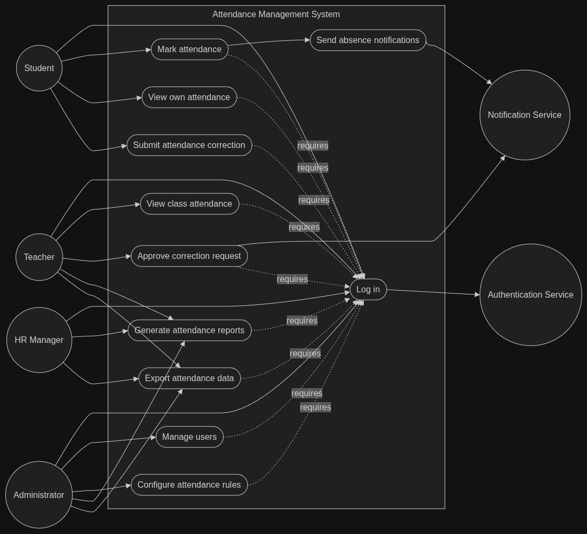
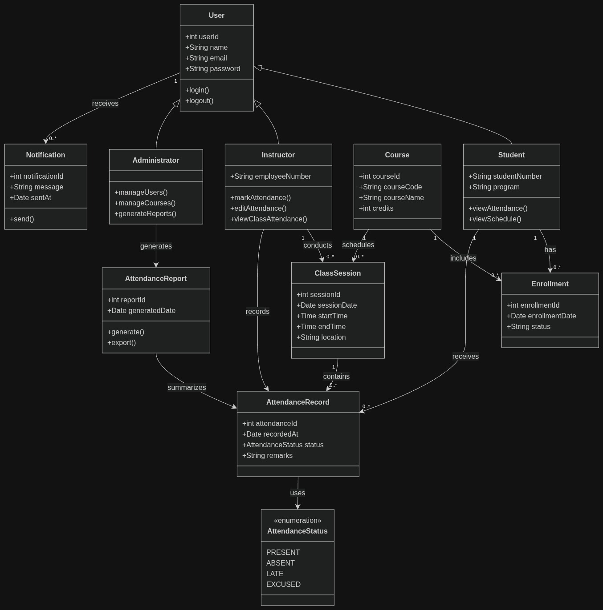

# Attendance Management System (AMS)
### *System Design, UML Models & Architecture Specifications*

---

## 📌 Overview

The **Attendance Management System (AMS)** is a companion academic software engineering module developed within the **Software_Group** initiative. While the **Leave Management System (LMS)** manages planned organizational and employee time-off, the **Attendance Management System** is designed to digitize and automate daily course-level and session-level attendance tracking, absence notification dispatch, correction workflows, and reporting for academic institutions and training organizations.

---

## 📐 System Models & Design Diagrams

### 1. Use Case Diagram

The Use Case Diagram captures the core operational boundaries of the Attendance Management System, mapping external actors to their functional privileges and interactions with internal and external services.



#### Actors & Functional Responsibilities:
- **Student:**
  - `Mark attendance`: Check-in for scheduled class sessions (triggers automated absence alerts if absent).
  - `View own attendance`: Check individual attendance percentages and historical logs.
  - `Submit attendance correction`: Request attendance status corrections with supporting explanations.
- **Teacher / Instructor:**
  - `View class attendance`: Monitor real-time student presence across assigned course sessions.
  - `Approve correction request`: Review and validate attendance rectification submitted by students.
  - `Mark / Edit attendance`: Record manual or override attendance entries for class sessions.
- **HR Manager / Academic Coordinator:**
  - `Generate attendance reports`: Aggregate session and student-level attendance summaries.
  - `Export attendance data`: Export tabular records (CSV/PDF) for administrative audits.
- **Administrator:**
  - `Manage users`: Provision and manage accounts for students, instructors, and coordinators.
  - `Configure attendance rules`: Set minimum required attendance thresholds and late cutoff policies.
- **Service Integrations:**
  - `Authentication Service`: Validates credentials across all protected endpoints (`Log in` requirement).
  - `Notification Service`: Dispatches automated alerts to students and staff upon absence or status modification.

---

### 2. Domain Class Diagram & Object Model

The Object-Oriented Class Diagram delineates the domain entities, relationships, attributes, and operations governing the system.



#### Vector PDF Document:
- [Attendance Management System Class Diagram (Vector PDF)](Attendance_Management_System_Class_Diagram.pdf)

#### Domain Entities Breakdown:

```
┌────────────────────────────────────────────────────────┐
│                         User                           │
│  +int userId                                           │
│  +String name                                          │
│  +String email                                         │
│  +String password                                      │
│  +login(), +logout()                                   │
└───────────────▲─────────────────▲────────────────▲─────┘
                │                 │                │
┌───────────────┴────────┐ ┌──────┴───────┐ ┌──────┴───────┐
│     Administrator      │ │  Instructor  │ │   Student    │
│  +manageUsers()        │ │  +employeeNo │ │  +studentNo  │
│  +manageCourses()      │ │  +markAtt()  │ │  +program    │
│  +generateReports()    │ │  +editAtt()  │ │  +viewAtt()  │
└────────────────────────┘ └──────┬───────┘ └──────┬───────┘
                                  │                │
                                  ▼                ▼
                           ┌──────────────┐ ┌──────────────┐
                           │ ClassSession │ │  Enrollment  │
                           └──────┬───────┘ └──────┬───────┘
                                  │                │
                                  ▼                ▼
                           ┌───────────────────────────────┐
                           │       AttendanceRecord        │
                           │  +AttendanceStatus status     │
                           └──────────────┬────────────────┘
                                          │
                                          ▼
                               ┌──────────────────────┐
                               │  «enumeration»       │
                               │  AttendanceStatus    │
                               │  - PRESENT           │
                               │  - ABSENT            │
                               │  - LATE              │
                               │  - EXCUSED           │
                               └──────────────────────┘
```

1. **`User` (Base Entity):**
   - Attributes: `userId: int`, `name: String`, `email: String`, `password: String`
   - Operations: `login()`, `logout()`
2. **`Student` (Specialization):**
   - Attributes: `studentNumber: String`, `program: String`
   - Operations: `viewAttendance()`, `viewSchedule()`
3. **`Instructor` (Specialization):**
   - Attributes: `employeeNumber: String`
   - Operations: `markAttendance()`, `editAttendance()`, `viewClassAttendance()`
4. **`Administrator` (Specialization):**
   - Operations: `manageUsers()`, `manageCourses()`, `generateReports()`
5. **`Course`:**
   - Attributes: `courseId: int`, `courseCode: String`, `courseName: String`, `credits: int`
   - Relationships: Schedules `0..*` `ClassSession`s, includes `0..*` `Enrollment`s.
6. **`ClassSession`:**
   - Attributes: `sessionId: int`, `sessionDate: Date`, `startTime: Time`, `endTime: Time`, `location: String`
   - Relationships: Conducted by `1` `Instructor`, contains `0..*` `AttendanceRecord`s.
7. **`Enrollment`:**
   - Attributes: `enrollmentId: int`, `enrollmentDate: Date`, `status: String`
   - Relationships: Has `1` `Student`, receives `0..*` `AttendanceRecord`s.
8. **`AttendanceRecord`:**
   - Attributes: `attendanceId: int`, `recordedAt: Date`, `status: AttendanceStatus`, `remarks: String`
   - Relationships: Recorded by `Instructor`, associated with `ClassSession` and `Enrollment`.
9. **`AttendanceStatus` (Enumeration):**
   - Values: `PRESENT`, `ABSENT`, `LATE`, `EXCUSED`
10. **`AttendanceReport`:**
    - Attributes: `reportId: int`, `generatedDate: Date`
    - Operations: `generate()`, `export()`
    - Relationships: Generated by `Administrator`, summarizes `AttendanceRecord`s.
11. **`Notification`:**
    - Attributes: `notificationId: int`, `message: String`, `sentAt: Date`
    - Operations: `send()`
    - Relationships: Received by `User` (`0..*`).

---

## 📁 Directory Structure

```text
docs/attendance-system/
├── README.md                                           # Attendance Management Documentation
├── Attendance_Management_System_Class_Diagram.pdf     # Vector draw.io Export
└── images/
    ├── attendance-use-case-diagram.jpg                # Use Case Diagram
    └── attendance-class-diagram.jpg                   # Object Domain Class Diagram
```
